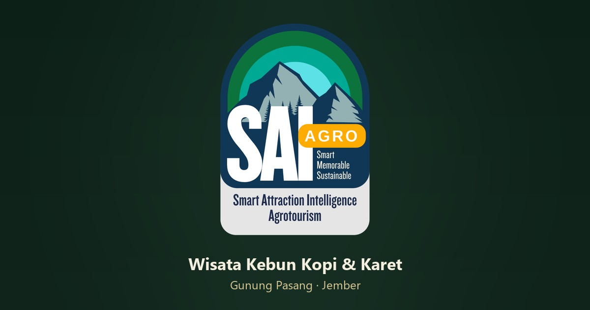

# BOMA Gunung Pasang



Kebun kopi, air terjun, dan udara gunung di Jember, dalam satu situs yang membantu orang memilih tujuan.

[Buka situs BOMA](https://boma.j-pims.com)

BOMA Gunung Pasang adalah kawasan wisata di lereng Gunung Pasang. Di dalamnya ada kebun kopi dan karet, air terjun, goa, candi, sampai area camping. Empat belas destinasi itu kini punya satu tempat untuk dilihat, dibandingkan, dan dipilih.

Situs ini dibuat untuk pengunjung yang datang dengan waktu terbatas. Kalau bingung harus ke mana, jawab tiga pertanyaan singkat. BOMA akan menunjukkan tempat yang paling cocok, lengkap dengan alasan kenapa tempat itu dipilih.

## Yang bisa dilakukan

- Melihat seluruh destinasi dan menyaringnya berdasarkan Minat Khusus, Alam, Buatan, atau Sosial Budaya.
- Mendapat rekomendasi dari tiga pertanyaan: seberapa aktif, berapa anggaran, dan bersama siapa.
- Membaca alasan di balik rekomendasi, bukan hanya daftar nama tempat.
- Membuka detail harga, durasi, dan tingkat aktivitas tiap destinasi.
- Menjelajah tanpa mouse. Fokus keyboard terlihat, dan dialog bisa ditutup dengan Escape.
- Menikmati animasi yang lebih tenang kalau pengaturan perangkat meminta gerak dikurangi.

## Cara BOMA memilih

Pertanyaan pertama adalah seberapa aktif pengunjung ingin bergerak. Jawaban itu menentukan cabang berikutnya: anggaran atau teman perjalanan. Dari sana ada tujuh hasil yang mungkin, dan setiap hasil membawa daftar destinasi beserta alasannya.

Alasan itu ditulis terbuka. Pengunjung bisa melihat kenapa Jeep Adventure muncul untuk satu jawaban, dan kenapa Tracking Air Terjun Tancak muncul untuk jawaban lain. Rekomendasinya bukan kotak hitam.

Pilihan juga tidak dikunci. Katalog tetap bisa dibuka kapan saja, termasuk oleh orang yang belum ingin menjawab pertanyaan.

## Rasa yang dibawa

Warna diambil dari kawasan: hijau tua, krem, dan pasir. Foto dipakai besar supaya orang bisa membayangkan tempatnya. Judul memakai Playfair Display, teks memakai Manrope.

Gerak dipakai untuk memberi arah, bukan mengisi ruang. Ada pergantian halaman, foto yang berganti pelan, dan dialog yang muncul setelah Beranda sempat bernapas. Kalau perangkat meminta gerak dikurangi, BOMA mengikuti pengaturan itu.

## Di balik layar

Situs ini dibangun dengan React 19, TypeScript, dan Vite. Tidak ada UI kit dan tidak ada pustaka animasi tambahan. Foto disajikan dalam WebP dengan ukuran yang sesuai layar, dan foto latar di halaman awal hanya memuat foto yang sedang tampil.

Font Manrope dan Playfair Display disajikan dari situs sendiri, jadi tidak ada permintaan ke Google Fonts.

## Menjalankan

Butuh Node.js 20.19 atau lebih baru.

```bash
npm install
npm run dev
```

Untuk membuat versi produksi:

```bash
npm run build
npm run preview
```

Hasil build ada di folder `dist` dan bisa diunggah ke hosting statis. Semua tautan memakai hash, jadi tidak perlu aturan rewrite di server.

Di PowerShell yang memblokir `npm.ps1`, jalankan `npm.cmd` dengan perintah yang sama.

## Kredit foto

Foto katalog berasal dari Wikimedia Commons. Judul berkas, pembuat, dan lisensi tiap foto tercatat di [`public/images/credits.json`](public/images/credits.json), termasuk CC BY, CC BY-SA, dan public domain.

## Lisensi

Repositori ini belum menyertakan berkas lisensi. Hubungi pemilik proyek sebelum memakai ulang kode atau aset di luar situs BOMA.

## Tentang

Dirancang dan dibangun oleh [mphstar](https://github.com/mphstar). Fokus proyek ini sederhana: membuat pilihan wisata terasa jelas, dan membuat halamannya tetap ringan di koneksi lambat.

Kalau ada masukan soal alur rekomendasi atau tampilan, buka issue di repositori ini.
